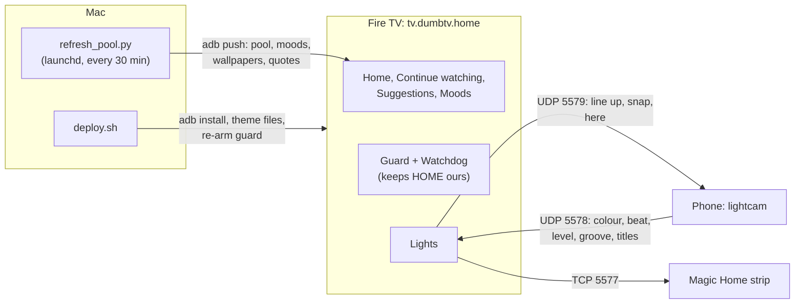

# Fire TV Cinema

A custom home screen for a Xiaomi Fire TV (Fire OS 7.7), plus an LED strip behind the TV that follows
what's playing. An old phone films the screen to get the picture's colour, and its microphone picks
up the beat.

Two projects share this repo because they share an app: the LED strip is driven by the same app as
the home screen, and that app needs both halves.

| | What it does |
|---|---|
| **Fire TV home** | Replaces Amazon's home screen. Shows drifting film wallpapers with a quote from each film, a dock of app logos, the time and weather, and four pages: apps, *Continue watching* (from any app), *Suggestions* (rebuilt every day from TMDB and IMDb, ranked by your taste) and *Moods* (a deck of cards, one per mood). Also replaces the screensaver and Alexa's search results. Underneath, ads and telemetry are switched off with [dumbtv](https://github.com/humblemuzzu/dumbtv). |
| **LED strip sync** | Drives a Magic Home Wi-Fi LED strip over the local network, with no cloud. Four modes: your own colour, the sound, the picture, or both. The phone filming the TV sends the picture's colour and the beat. With no phone, the strip takes its colours from the title's artwork. |

## How the pieces talk



Outside services: TMDB (titles, artwork, where each title streams), IMDb's public ratings file,
Open-Meteo (weather, no key needed), the YouTube Data API (Continue watching for YouTube) and Gemini
(the phone reads the title off the screen for Netflix and Apple TV, which don't report it).

## What's where

```
tv-home/                       everything that runs on the TV and the phone (began as a fork of dumbtv)
├── deploy.sh                  build, install, push theme files, re-arm the HOME guard
├── deploy.conf.example        copy to deploy.conf: the TV's and the phone's adb addresses
├── launcher/                  the TV app (tv.dumbtv.home): plain Android SDK build, no Gradle
│   └── src/tv/dumbtv/home/
├── lightcam/                  the phone app (tv.dumbtv.lightcam): camera + microphone -> TV
├── scripts/                   dumbtv's debloat, restore, verify and DNS filter scripts
├── data/, catalog/            dumbtv's package lists and device catalogue
└── tests/                     dumbtv's script tests
tv-assets/                     the Mac side
├── tools/                     the daily refresh, finding the TV, taste scoring, character cut-outs
├── quotes-extra.txt           extra quotes for the home screen
└── tv/                        theme files pushed to the TV (dock.txt, favourites.txt, weather.txt)
docs/
├── fire-tv-home.md            pages, theme files, the HOME guard and Fire OS quirks
└── led-strip-sync.md          modes, the Magic Home protocol, lining up the camera, sound
```

### Which code belongs to which project

| Project | Files |
|---|---|
| Fire TV home | `launcher/…/Home.java` (dock, pages, weather), `Continue.java` + `Watching.java` (Continue watching), `Favourites.java` (Suggestions), `Moods.java`, `Walls.java`, `Dream.java` (screensaver), `Search.java` (Alexa results), `Guard.java` + `Watchdog.java` + `Keeper.java` (keep HOME ours), `Library.java` (all apps and inputs), `Tmdb.java`, `Weather.java` |
| LED strip sync, TV side | `Lights.java` (modes and media sessions), `Strip.java` (Magic Home over TCP), `StripModel.java` (how the LEDs dim each other), `Palette.java` (colours from artwork), `Calibrate.java` + `SoundCalibrate.java` (line up the camera and the sound), `BrightnessBar.java` + `Toggle.java` (the light menu) |
| LED strip sync, phone side | `lightcam/src/tv/dumbtv/lightcam/`: `Main.java` (camera, screen outline, colour), `Pulse.java` + `Band.java` + `Biquad.java` (strobe on bass, mids, highs), `Groove.java` (the gradual mode), `SoundTune.java` (sound calibration), `Snap.java` (reads titles with Gemini), `Power.java` (comes back after power cuts) |
| Mac | `tv-assets/tools/refresh_pool.py` (builds and pushes Suggestions, moods, light-strip titles, wallpapers and quotes every day), `find_tv.py` (finds the TV again after its address changes), `taste.py`, `cutout.swift` (cuts characters out of stills with macOS Vision), `prep_characters.py`, `preview_lineup.py` |
| Debloat (dumbtv) | `tv-home/scripts/`, `tv-home/data/`, `tv-home/catalog/`, see [tv-home/README.md](tv-home/README.md) |

## Setting it up

You need: macOS, JDK 17 (`brew install openjdk@17`), the Android command-line tools with
`platforms;android-25` and any build-tools, `adb`, Python 3 with Pillow, and Swift (Xcode command-line
tools). Keep `tv-home/` and `tv-assets/` side by side, because the scripts look for `../tv-assets`.

1. **Private files.** None of these are in the repo. Create them yourself:

   | File | What goes in it |
   |---|---|
   | `tv-home/deploy.conf` | `ANDROID_SERIAL=<tv-ip>:5555` and `PHONE_SERIAL=<phone-ip>:<port>` (see `deploy.conf.example`) |
   | `tv-assets/tmdb.key` | a TMDB API key (v3) |
   | `tv-assets/youtube.key` | a YouTube Data API key (optional: YouTube cards in Continue watching) |
   | `tv-assets/gemini.key` | a Google AI Studio key (optional: the phone reads Netflix and Apple TV titles) |
   | `tv-assets/tv/weather.txt` | `latitude longitude` (see `weather.txt.example`; leave it out for no weather) |
   | `tv-assets/taste.json` | optional taste profile (see `taste.example.json`) |
   | `tv-assets/tv/{wallpapers,logos,icons,fonts,characters,scenes}/` | your images and fonts |

   The first build creates `launcher/release.keystore` and `lightcam/release.keystore`. **Keep them:**
   Android only accepts an update signed with the same key.

2. **Debloat the TV** with dumbtv. Follow [tv-home/AGENTS.md](tv-home/AGENTS.md): `./scripts/configure.sh`,
   then `./scripts/all.sh` and `./scripts/verify.sh`. `./scripts/restore.sh` undoes it.

3. **Install the home screen.** In `tv-home/`:

   ```bash
   ./deploy.sh           # build, install, push theme files, re-arm the HOME guard
   ./deploy.sh assets    # theme files only, no rebuild
   ./deploy.sh quiet     # update without waking the TV or bringing up the home screen
   ```

4. **The daily refresh** (Suggestions, moods, wallpapers, quotes):

   ```bash
   swiftc -O tv-assets/tools/cutout.swift -o tv-assets/tools/cutout
   python3 -I tv-assets/tools/refresh_pool.py            # refresh and push now
   ```

   To run it on a schedule, edit the paths in `tv-assets/tools/com.shashank.tv-favourites.plist`,
   copy it to `~/Library/LaunchAgents/` and `launchctl load` it. macOS doesn't let background jobs
   into `~/Documents`, so keep `tv-assets` somewhere else (for example `~/tv-assets`, with a symlink
   next to `tv-home`).

5. **The phone** (optional, for live picture and sound): turn on Wireless debugging, `adb pair`
   with it, put its address in `deploy.conf`, then run `./lightcam/deploy.sh`. Stand it where it
   sees the whole screen, and line it up from the TV's light menu (the viewfinder icon). The
   details are in [docs/led-strip-sync.md](docs/led-strip-sync.md).

## What's not in this repo

Left out on purpose: API keys, the TV's and phone's addresses, the TV's serial number, the weather
location, the personal taste profile, the signing keystores, and the TV's settings snapshot (`report/`).
Copyrighted images (film stills, app logos, character cut-outs), fonts, and anything generated
(`tv-assets/cache/`, `tv-assets/tv/pool/`) are also left out.

## Credits

`tv-home/` began as a fork of [dumbtv](https://github.com/humblemuzzu/dumbtv) by humblemuzzu and
contributors (MIT; its licence is in [tv-home/LICENSE](tv-home/LICENSE)). This product uses the TMDB API
but is not endorsed or certified by TMDB. Ratings come from IMDb's non-commercial datasets.
Weather comes from [Open-Meteo](https://open-meteo.com).
